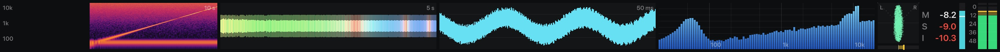

## Context

When I mix in Ableton Live, I want meters on screen at all times without opening a plugin on the master track. I used MiniMeters for that, but its output capture is unreliable on macOS Tahoe.

audio_monitor is my own replacement. It docks as a thin strip at a screen edge, or runs as a dashboard window or full screen on a second monitor. Instead of capturing the output device, it taps the Ableton Live process directly with a Core Audio process tap. With the **All System Audio** source it also works with any other app.

## Approach

I built it in Claude Code sessions. The focus was low CPU use and low latency:

- **Nothing blocks the audio thread.** The Core Audio IO proc only copies stereo frames into a lock-free ring buffer and runs the loudness meter. It never allocates or locks.
- **Analysis once per frame.** On the main thread, peak, RMS, correlation and a single FFT shared by spectrum and spectrogram run with Accelerate. Only the samples that arrived since the last frame are processed.
- **One draw call.** Every bar, line, dot and glyph is an instanced quad in Metal, drawn in one call per frame. Text comes from a glyph atlas, and the spectrogram is a ring texture that receives one column at a time.
- **Stop when there is nothing to show.** Rendering pauses completely when the audio is silent or the bar is hidden.
- **Measured, not assumed.** A `--selftest` switch runs the EBU Tech 3341 loudness cases and correlation tests. A synthetic test signal and an offscreen snapshot mode let me check layouts without playing audio.

## What it does

- Level meters with sample peak, 300 ms RMS, peak hold and a clip indicator.
- Loudness after EBU R128 / ITU-R BS.1770-4: momentary, short-term and integrated LUFS, with a target that colours the readouts.
- Spectrum, scrolling spectrogram, waveform history coloured by low, mid and high energy, and an oscilloscope with optional zero-crossing trigger.
- Goniometer and stereo correlation meter.
- Docks to any screen edge in five thickness steps, floats freely or passes clicks through. Everything is set from the right-click menu or the menu bar icon.

## Outcome

The app runs on macOS 26 with Apple silicon and is open source under the MIT licence. With every view on and the bar at full screen width, it uses roughly 5 % of one core at 30 fps and under 0.5 % while paused on silence. Most of that cost is macOS presenting frames, not the analysis.
