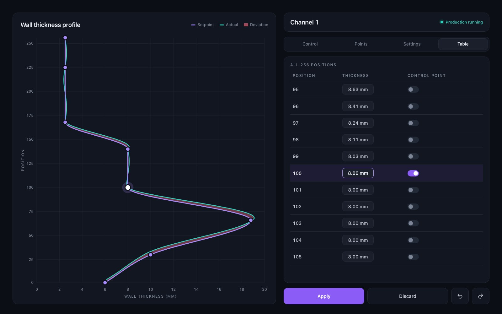

## Context

A mechanical engineering company that builds extruders for plastics manufacturers needed a new way to set the wall thickness of the extruded part. Operators had to shape the thickness along the whole length, see what the machine actually did and correct it, using touch or a mouse.

The rest of the extruder is operated through a Siemens WinCC application, which was being ported to WinCC Unified. The new tool had to live inside it.

_The screens on this page are redrawn and anonymized versions of my mockups. They don't show the customer's real data._

## My role

I worked on the project from first mockup to handover:

- Prototyped the interface as mockups.
- Built the frontend with React and D3.js and the backend with .NET.
- Connected the backend to the machine over OPC UA.
- Delivered the source code with full documentation and a detailed user manual.

## Approach

- **256 control points.** The curve has one control point per position. Each one can be turned on or off and edited on its own: by dragging it on the chart with touch or mouse, or by typing a value.
- **An interpolation that matches the machine.** The active points are joined by an interpolated curve, and that curve has to match how the extruder nozzle really moves between them. Otherwise the screen promises a profile the machine can't run. So I calculated the interpolation myself instead of using a generic curve from a library.
- **Setpoint against actual.** The chart draws the configured curve and the one the machine actually ran, and it shades the area between them, so deviations are easy to spot.
- **Custom visualization.** The chart and all touch and mouse interactions are built from scratch with D3.js inside React.

## The hard parts

- **Getting the interpolation right.** The drawn curve had to match what the nozzle actually does between control points.
- **Running inside WinCC Unified.** WinCC Unified supports custom web controls, so the wall thickness control runs as one of them, next to the screens that operate the rest of the extruder.

## Outcome

The wall thickness control was used successfully in live production tests. The customer received the source code, the documentation and a user manual.
